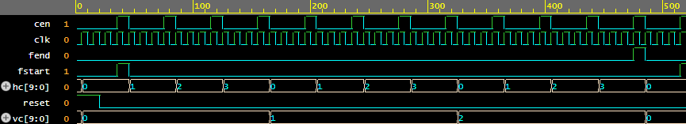
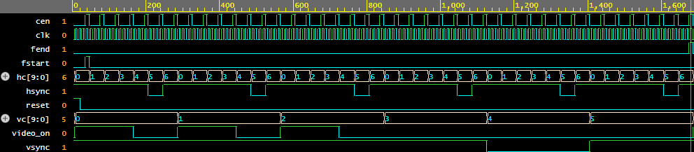

# fpga-pong

My attempt at building Pong in SystemVerilog, with VGA output (640x480 @ 60Hz). I’m doing this to learn RTL design instead of just reading about it, so the code is written by me, using tutorials and references along the way.

For now I’m verifying everything through simulations until I can get access to a board to test on.

## Layout

- `rtl/` design files

- `tb/` testbenches

- `docs/` waveforms and notes

## Completed modules

- `frame_counter`: counts `hc` (0-799) and `vc` (0-524) across the whole frame, including the blanking area. Advances on a pixel tick `cen` instead of a divided clock. Also outputs `fstart` and `fend`, one-cycle pulses at the first and last pixel of each frame. The game logic will use these later to update once per frame.

- `vga_sync`: takes hc/vc and generates `hsync`, `vsync` and `video_on`. Timing values are parameters, so I can test with a tiny 7x6 "screen" instead of scrolling through 420,000 cycles.

Both are tested in EDA Playground.

## frame_counter test

Tested with a tiny 4x3 frame (HMAX=4, VMAX=3) and cen high 1 in every 4 clocks, so one frame is 480 ns.

What to look for:
- `hc` counts 0-3 and wraps, only changing on cen
- `vc` steps once each time `hc` wraps, 0-2 then back to 0
- `fstart` pulses for one clock at (0,0), `fend` for one clock at (3,2)

## vga_sync test

frame_counter and vga_sync connected together, using a 7x6 frame: 4 visible + 1 front porch + 1 sync + 1 back porch horizontally, 3 + 1 + 1 + 1 vertically. One frame is 1680 ns.

What to look for:
- `hsync` goes low only when `hc` = 5, once per line
- `vsync` goes low only during line 4, once per frame
- `video_on` is high only for `hc` 0-3 on lines 0-2

## Things I got wrong 

- Originally had `fend` as a level, not a pulse. With `cen` high only 1 in 4 clocks, it stayed high for 4 cycles, which would make the game update 4 times per frame. Fixed by ANDing with cen.
- Made `hsync` low for the whole blanking period instead of just the sync pulse.

## Next

- [ x] draw paddles + ball (static)
- [ ] dump a frame to an image file so I can see it without a monitor 
- [ ] paddle movement
- [ ] ball physics / collisions
- [ ] scoring + game states
- [ ] get it on real hardware

