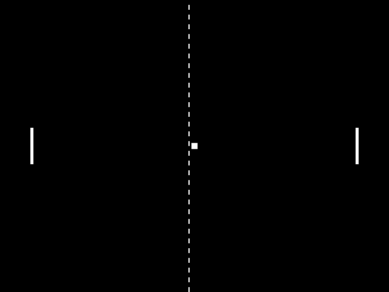
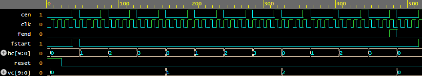
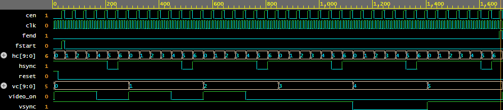

# fpga-pong

My attempt at building Pong in SystemVerilog, with VGA output (640x480 @ 60Hz). I’m doing this to learn RTL design, so the code is written by me, using tutorials and references along the way for the VGA parts.

Everything is verified in simulation, and I'm now bringing it up on a Digilent Nexys 4 FPGA board (see [Running on a Nexys 4](#running-on-a-nexys-4-fpga)). The full design also passes the Tiny Tapeout GF180 build (synthesis, place and route, DRC, gate-level test) in one tile.

## How to play

You can play it in your browser! Go to [VGA Playground](https://vga-playground.com) and open the **Gamepad** preset. Replace everything in its `project.v` tab with the contents of `playground/tt_um_pong.sv`, which contains the whole design. It compiles automatically and starts running on the virtual VGA screen. Turn on the gamepad above the display by clicking the game controller icon, click the screen so it gets your key presses, and play: player 1 uses the **up/down arrow keys**, player 2 uses **X/B**, **S** switches between 2-player and vs. computer, **T** changes the difficulty and restarts, and **Shift+R** resets the game. First to 5 wins!

## Layout

- `rtl/` design files (one module per file)
- `fpga/nexys4/` Nexys 4 top level and pin constraints
- `playground/` the whole design in one file, ready to paste into VGA Playground
- `tb/` testbenches
- `docs/` waveforms, frames and notes

## Modules

- `frame_counter`: counts `hc` (0-799) and `vc` (0-524) across the whole frame, including the blanking area. Advances on a pixel tick `cen` instead of a divided clock. Also outputs `fstart` and `fend`, one-cycle pulses at the first and last pixel of each frame. The game logic uses `fend` to update once per frame.

- `vga_sync`: takes hc/vc and generates `hsync`, `vsync` and `video_on`. Timing values are parameters, so I can test with a tiny 7x6 "screen" instead of scrolling through 420,000 cycles.

- `render`: the game itself. Holds the paddle positions, ball position and ball direction in registers and updates them on `fend`. Checks for wall and paddle hits, re-serves the ball from the centre when a player misses, and draws the paddles, ball and dashed centre line by comparing the current pixel against each object's bounds. Also keeps the score (first to 5 wins), speeds the ball up the longer a rally goes, and runs the computer paddle in 1-player mode. Draws a 1-pixel border around the screen.

- `digit`: draws one seven-segment digit on screen at a given position, used for the scores.

- `sevenSegment`: turns each score into the segments to light up. Player 2's 1 is drawn on the left so it sits next to the centre line.

- `tt_um_pong`: top level in the Tiny Tapeout pin format. Connects the modules, reads a Gamepad Pmod (and plain buttons on `ui_in[3:0]`), and outputs RGB + sync on the TinyVGA Pmod pins. Select (or button 7) toggles 1-player / 2-player, Start cycles the computer's difficulty and restarts the game.

- `nexys4_top` (in `fpga/nexys4/`): top level for the Nexys 4 board. Makes the 25 MHz pixel tick from the 100 MHz clock with a 1-in-4 `cen`, passes the buttons and switches through two-flip-flop synchronizers, and drives the board's 12-bit VGA port (all 4 bits per colour).

- Gamepad input uses the Gamepad Pmod driver (`gamepad_pmod.v` by Pat Deegan, Apache-2.0), which is already included in VGA Playground's Gamepad example.

  
The game was tested in EDA Playground up until the addition of different modes, at which point I began testing it directly on VGA Playground.

## frame_counter test

Tested with a tiny 4x3 frame (HMAX=4, VMAX=3) and cen high 1 in every 4 clocks, so one frame is 480 ns.

What to look for:
- `hc` counts 0-3 and wraps, only changing on cen
- `vc` steps once each time `hc` wraps, 0-2 then back to 0
- `fstart` pulses for one clock at (0,0), `fend` for one clock at (3,2)

## vga_sync test

frame_counter and vga_sync connected together, using a 7x6 frame: 4 visible + 1 front porch + 1 sync + 1 back porch horizontally, 3 + 1 + 1 + 1 vertically. One frame is 1680 ns.

What to look for:
- `hsync` goes low only when `hc` = 5, once per line
- `vsync` goes low only during line 4, once per frame
- `video_on` is high only for `hc` 0-3 on lines 0-2

## render test

`render_tb` runs the full 640x480 design and writes every frame to a PPM image (`frame0.ppm`, `frame1.ppm`, ...), so I can see the game without a monitor. It moves the paddles with fake button presses and checks that the ball bounces off the walls and paddles and gets re-served after a miss.

## nexys4_top test

`nexys4_top_tb` runs the board top level from a 100 MHz clock and measures the horizontal sync:

- `hsync` pulse: 3,840 ns (96 pixels x 40 ns) ✅
- one line, falling edge to falling edge: 32,000 ns (800 pixels x 40 ns) ✅

This confirms the 1-in-4 clock enable gives correct 640x480 timing from the board clock.

## Running on a Nexys 4 FPGA

Status: simulated, hardware bring-up in progress.

| Control | Board |
|---|---|
| Player 1 up / down | BTNU / BTND |
| Player 2 up / down | BTNL / BTNR |
| Mode (off = 2-player, on = vs computer) | SW2 |
| Difficulty | SW1-SW0 |
| Reset | CPU_RESET (red button) |

Pick the constraints file that matches the name printed on the board:
- `nexys_a7.xdc` for a Nexys A7 or Nexys 4 DDR
- `nexys4_original.xdc` for an original Nexys 4 (its buttons and switches are on different pins)

To build in Vivado: create an RTL project for part `XC7A100TCSG324-1`, add `rtl/*.sv`, `fpga/nexys4/nexys4_top.sv` and one of the `.xdc` files, set `nexys4_top` as top, generate the bitstream and program the board. Connect a VGA monitor and play.

## Things I got wrong

- Originally had `fend` as a level, not a pulse. With `cen` high only 1 in 4 clocks, it stayed high for 4 cycles, which would make the game update 4 times per frame. Fixed by ANDing with cen.
- Made `hsync` low for the whole blanking period instead of just the sync pulse.
- Paddle hit windows were narrower than one ball step, so the ball could jump straight through a paddle. Widened them by one step.
- Used unsigned subtraction (`Lpad_Y - BALL`), which wraps to a huge number near the top of the screen. Moved terms to the other side of the comparison so nothing gets subtracted.
- Flipped the ball's direction on a hit instead of setting it, so a ball that stayed in the hit zone for two frames jittered in place.
- The re-serve after a miss was written above the normal movement code, so the movement's nonblocking assignments overwrote it and the ball never reset.
- The ball bounced one frame late: the direction register updated on the same clock edge as the movement, so the ball took one more step into the wall or paddle. At high speed, that extra step after a paddle hit landed in the "missed" zone and gave the other player a point. Fixed by computing the next direction combinationally (`nextDirX`/`nextDirY`) and using it for the move on the same frame.
- Wrote ports like `input logic clk, logic reset`. The browser simulator accepted it, but Icarus and the chip flow didn't. Every port now has its own direction.
- Wrote the computer paddle's speed as `{7'b0, mpf_com+SpeedUp/2}`. The `2` is an unsized number, which isn't allowed inside a concatenation, so the strict compiler rejected it. Now computed as a separate 10-bit `comSpd`. Also had `hc>=0` checks in the screen border, which are always true for unsigned values and got flagged too.

## Next

- [x] draw paddles + ball (static)
- [x] dump a frame to an image file so I can see it without a monitor
- [x] paddle movement
- [x] ball physics / collisions
- [x] scoring + game states
- [x] 1-player mode (computer paddle)
- [ ] get it on real hardware
